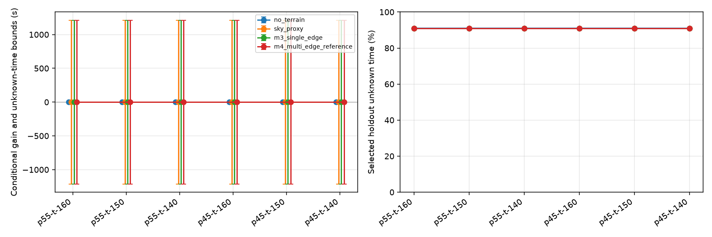

# E4 固定决策的信息层级实验

2026-10-10，G14 已通过 [Round 14 独立审查](e4-gate.md)，验收限于声明的条件研究范围。研究判断为 `inconclusive_due_reference_unknowns`：当前冻结的真实地形参考尚不足以判断精细传播信息的选址收益。框架已执行四层信息、六组情景和共同留出评价，不代表物理传播或实际服务验收。

冻结设计见 [e4-design](e4-design.md)、[独立设计分析](e4-design-review.md)、[来源与划分](e4-design-sources.json)。配置 SHA256 为 `sha256:072210b38c6bf7f9e90797987ae157a19af9576c64d967850d0e915f9970609b`。三个独立中心的 60 m 秦岭 DSM 网格、3 km 半径、2 m 相对地表高度、相同安装成本；第 5–6 完整过境开发，第 7–8 留出。EIRP 55/45 dBm × 门限 −160/−150/−140 dBm 全部保留。输入准备运行约 19.974 s，归档 `output/m6-e4-inputs-final-20261010`。

24 份开发凭据在任何留出传播开始前保存，审计验证了顺序和凭据内容。每组情景的全部方法共用同一个 HoldoutScores，不用隐藏参考重新选点。

| EIRP / 门限 (dBm) | 无地形选择 | 天空代理选择 | M3 选择 | M4 选择 | M3 gain / regret (s) | M3 所选点留出未知 (s) |
| --- | --- | --- | --- | --- | ---: | ---: |
| 55 / -160 | Q_E300 | Q0 | Q0 | Q0 | 0.000000 / 0.000000 | 1212.167968 |
| 55 / -150 | Q_E300 | Q0 | Q0 | Q0 | 0.000000 / 0.000000 | 1212.167968 |
| 55 / -140 | Q_E300 | Q0 | Q0 | Q0 | 0.000000 / 0.000000 | 1212.167968 |
| 45 / -160 | Q_E300 | Q0 | Q0 | Q0 | 0.000000 / 0.000000 | 1212.167968 |
| 45 / -150 | Q_E300 | Q0 | Q0 | Q0 | 0.000000 / 0.000000 | 1212.167968 |
| 45 / -140 | Q_N300 | Q0 | Q0 | Q0 | -0.000000 / 0.000000 | 1212.167968 |

所有 24 组方法评价、完整候选排名、分量与上下界见 [机器摘要](e4.json)、[结果 CSV](e4-results.csv) 和运行内 evaluations.json。**保守目标的零 gain/regret 不能解读成真实无收益或实际最优**；未知时间按上界计入导致参考的决策辨识能力不足。各方法保留了不同开发选择。天空轮廓只能确定遮挡，清晰仍为质量未知；在本目标下其评分退化为全观察时长并按 ID 并列选择。M4 的并列也与参考未知有关，不能当成支持原点的物理证据。

空间资格在每个新增直接时刻检查 15/7.5/3.75 m：两次 raw 损耗差≤0.1 dB，LOS/截顶一致，全部完成。在 51291 个唯一直接时刻中，38395 个通过该条件、8356 个未验证、4540 个在几何地平线下；查询次数不是时间加权分母。最大相邻 raw 差为 48.263288 dB。逐点结果、配对身份、原始/截顶损耗及剖面恢复信息保存在 propagation.jsonl 中。

完整时段参考资格为 0/72；其中留出 0/36。直接时间层级固定为 1/0.5/0.25 s，交叉括号 0.05/0.025/0.0125 s。没有追加更细层级或事后放宽条件。当前严格协议中，有空间未知的时间序列不能获得完整时间参考资格；失败候选的整段过境质量转为未知，仍保留几何不可见和完整观察分母。

这比逐点保留部分参考更保守。原始细化诊断并未删除，[参考资格 CSV](e4-reference.csv) 同时列出资格检查前的已知足够/不足/不可见/未知秒数和最终未知秒数。累计不足为零时需结合未知看待，不能解释为连通。最长已知不可用不跨未观察过境空隙；各候选最长门限不足另保存在 diagnostics.json。正式时间误差与业务标准仍未确定。

本图用同一 results.csv 重新绘制，显示未知时间界限和 0–100% 全分母；原归档初版图的自动缩放会放大约 1e-13 s 的舍入差，故保留原图作为历史产物而使用上述展示图。机器表保留原浮点值，表中六位小数的正/负零均在冻结的 1e-6 s 并列容差内。误差线是未知时间的条件上下界，不是统计置信区间。

实际计算运行 1363.457 s，峰值 RSS 219984 KiB（全进程共享）。直接查询 51291 次，分析调用 981406 次，相同传播按身份复用于功率/门限与时间加密；这不是在线加速基准。角色求解累计秒数为 `{'m3_current_single_edge_v1': 274.8715389641002, 'reference_multi_edge_deygout_v1': 108.18854935001582, 'sky_horizon_outline_v1': 43.56488472223282}`。角色计时包含三个空间层级的配对审计工作，不能解释成单独部署某方法的耗时。事件总时长包含传播/派生，不与这些分量相加；输入读取、共同准备、角色、事件/门限派生、选择、评价/I/O 分开保留于 [成本 CSV](e4-costs.csv) 和运行 costs.json。安装成本与计算时间没有混入同一目标。

全量 **447 passed in 8.73 s**。归档审计核对 588 个文件哈希、51291 条直接传播身份、324 个事件输入及 180 个最终评分，重建积分和所有评分 source_id；见 [审计记录](e4-audit.json)。实验期间另补了天空代理在无几何/地平线下禁止伪造功率预算的输入验证，合法样本计算不变；使用当前实现重建全部事件证明一致。实际运行版本由 sources.zip 和 environment.json 的源码哈希锁定，不能仅用工作区 HEAD 代替。

初次输入准备的属性名错误保存在 `output/m6-e4-inputs-20261010` 失败归档，修复后建立新目录，未覆盖旧运行。最终传播归档为 `output/m6-e4-20261010`，含源码、配置、三网格、输入 TLE、凭据、逐时刻传播、事件及图表。它与其它阶段归档一样，不替代 G15 的新环境小型完整复现包。

研究上应先改进/解释多边缘参考的离散化稳定性，再评估真实任务收益；本次证据不足以支持部署价值。软件交付下一项仍是 G15 新环境复现和 G16 全 AC/问题账本及代码审查。minimum_useful_gain、max_compute_budget、allowed_event_error 未定；有限半径之外、DSM 拼接来源、真实服务与旧 reference 专有流水线问题都未被本实验关闭。
